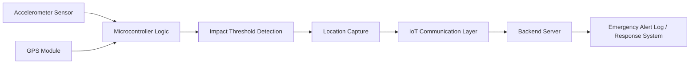

# IoT-Based Accident Avoidance and Location Sharing System


An embedded systems and IoT project designed to detect vehicle accidents using a MEMS accelerometer, GPS module, and microcontroller-based communication. The system monitors abnormal acceleration, captures the current location, and transmits emergency data to a backend service to support faster response coordination.

## Overview

This project focuses on developing a smart accident detection and location-sharing solution for vehicles. By integrating sensors, communication modules, and a server-side logging layer, the system demonstrates a practical safety application for connected transportation and emergency response support.

## Why This Project Matters

- Supports faster emergency response through location sharing
- Combines embedded hardware and software into a real-world system
- Shows capability in sensors, communication, and IoT integration
- Highlights practical design thinking for road safety solutions

## Key Features

- MEMS accelerometer-based accident detection
- GPS coordinate retrieval
- Threshold-based impact analysis
- Emergency alert transmission over IoT communication
- Backend service for logging and alert management
- Prototype-ready embedded system design

## Architecture



## Repository Structure

```text
iot-accident-avoidance-location-sharing/
├── README.md
├── requirements.txt
├── .gitignore
├── firmware/
│   └── accident_monitor.ino
├── backend/
│   ├── __init__.py
│   ├── server.py
│   ├── simulator.py
│   └── emergency_log.json
├── docs/
│   └── wiring-guide.md
├── data/
│   └── sample_alerts.json
└── .gitkeep
```

## Tech Stack

- Embedded C / Arduino
- Python / Flask
- GPS module integration
- Accelerometer sensor design
- Wi-Fi-based alert communication

## Hardware Components

- Microcontroller (Arduino / ESP32 / MCU board)
- MEMS accelerometer (MPU6050 / ADXL345)
- GPS module (NEO-6M or similar)
- Wi-Fi connectivity
- Optional buzzer, LEDs, or display indicators

## Quick Start

### 1. Clone the repository

```bash
git clone https://github.com/Fs-ilm26/iot-accident-avoidance-location-sharing.git
cd iot-accident-avoidance-location-sharing
```

### 2. Install backend dependencies

```bash
python -m venv .venv
source .venv/bin/activate
pip install -r requirements.txt
```

### 3. Start the backend server

```bash
python backend/server.py
```

### 4. Run the simulator

```bash
python backend/simulator.py
```

### 5. Upload the firmware

Open the Arduino file and configure your Wi-Fi credentials and endpoint details:

```bash
firmware/accident_monitor.ino
```

## Workflow

1. The accelerometer continuously monitors motion and vibration.
2. Significant impact crosses the configured threshold.
3. GPS coordinates are fetched immediately.
4. The microcontroller sends the emergency data to a backend endpoint.
5. The alert is logged and made available for response coordination.

## Sample Alert Payload

```json
{
  "device_id": "vehicle_01",
  "lat": 19.0760,
  "lon": 72.8777,
  "impact": 3.25,
  "status": "critical"
}
```

## Safety Considerations

- Sensor calibration is essential for reliable accident detection
- Real-world validation should include repeated testing under different conditions
- GPS accuracy should be checked in low-signal environments

## Project Impact

This project demonstrates practical ability in embedded design, sensor integration, and IoT communication. It reflects strong skills in system design, hardware-software interaction, and solving real-world safety and emergency-responsiveness challenges.

## License

This project is licensed under the MIT License.

## Future Enhancements

- SMS and email alert integrations
- Visual map dashboard for emergency incidents
- Cloud storage and analytics
- Improved threshold calibration for different vehicle conditions
- GSM fallback communication for network outages

---

This repository is presented as a professional IoT safety solution combining embedded hardware, real-time location tracking, and emergency alert communication.
